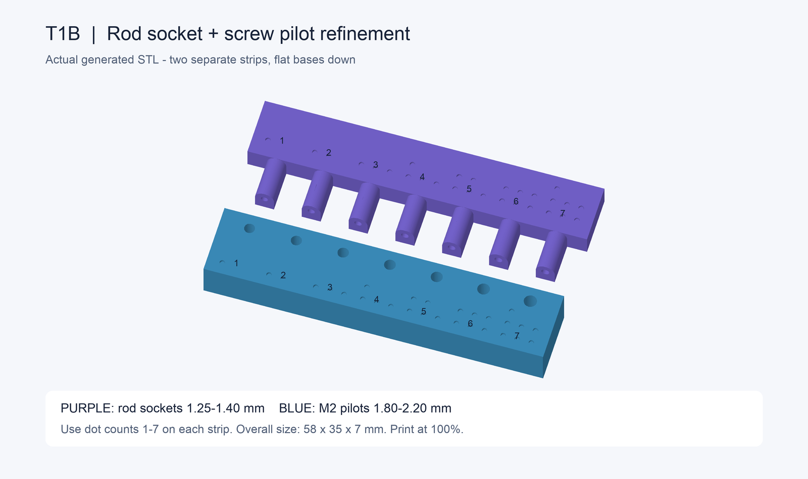

# T1B — socket and screw refinement

Prepared 2026-10-09 from the user's T1 results. This is an **untested refinement coupon**, not a final cage part. The original T1 file, the cutting jig, and all main-part STLs remain available unchanged.

Load **[T1B_socket_and_screw_refinement.stl](T1B_socket_and_screw_refinement.stl)** in FlashPrint. It contains two separate strips in a 58 × 35 × 7 mm footprint. Both are flat at Z = 0; centered with a 5 mm brim, the footprint is approximately 68 × 45 mm. Keep **100% scale and the supplied orientation**. Remove the old models first. No diagonal rotation is needed for this small coupon.



## Print settings

Select **Voxel PETG T1 sockets** and apply the successful adhesion settings below. The previously saved starter profile may still have brim off and a 15 mm/s first-layer limit; check these fields before slicing.

| Setting | Value |
| --- | --- |
| Layer height / first-layer height | 0.15 / 0.27 mm |
| Shells / top / bottom | 3 / 5 / 5 |
| Infill | 25%, Hexagon |
| Print / travel speed | 35 / 100 mm/s |
| First-layer maximum speed | 10 mm/s |
| Nozzle temperature | Same as successful T1 (235°C if unchanged) |
| Bed temperature | 60°C |
| Retraction | Same as successful T1 (1.5 mm at 30 mm/s if unchanged) |
| Fan | Same as successful T1 (on at 0.6 mm if unchanged) |
| Brim | Enabled, 5 mm, 1 layer, speed 25% |
| Supports / raft / XY compensation | Off / off / off |
| Plate preparation | Clean plate, thin even washable glue-stick coat |

Slice again and confirm the complete brim is inside the bed. The strips' brims may join; trim that connecting material after cooling without changing any test hole. No print was started by creating this file.

## Identify the holes

**Use the dots on each strip; left/right depends on how you hold it. New dot counts refer only to T1B, not the original T1.**

| Dots | Horizontal rod socket, drawn diameter | Top screw pilot, drawn diameter |
| --- | --- | --- |
| 1 | 1.250 mm | 1.80 mm |
| 2 | 1.275 mm | 1.85 mm |
| 3 | 1.300 mm | 1.90 mm |
| 4 | 1.325 mm | 1.95 mm |
| 5 | 1.350 mm | 2.00 mm |
| 6 | 1.375 mm | 2.10 mm |
| 7 | 1.400 mm | 2.20 mm |

The original snug socket was tentatively identified as three dots, nominally 1.30 mm. This range includes that reference and slightly larger bores, plus smaller controls. Fine CAD increments do not guarantee equally fine changes in printed fit; report the actual feel. The socket axis, arm diameter, supporting keel and 5 mm insertion depth match the original coupon construction.

The user confirmed turning the M2 × 4 mm screw with an Allen key; none of the original pilots would start. T1B includes the original largest pilot as a control and progressively larger candidates. All pilot holes are blind, 5 mm deep in a 7 mm block. The 2.20 mm candidate is a clearance diagnostic: accepting the screw easily is not proof of holding a thread.

## Test after cooling

1. Remove brim and loose strings without drilling, sanding or enlarging holes. Use the same carbon rod as the original T1.
2. Start with rod socket **3 dots** (the 1.30 mm reference), then **4** and **5**. The rod should enter the full 5 mm with firm finger pressure, remain in place when gently shaken, and come out with a firm pull. Check the other sockets if needed; do not force a tight one.
3. Use **M2 × 4 mm socket-head screws**, no nut or washer, in the other strip's top holes. Prefer a fresh screw of the same size for each hole so stuck plastic on a screw does not bias the next test. Start with the largest candidates, then work toward smaller ones to find a secure fit.
4. Keep the screw perpendicular, turn slowly by hand, and stop for excessive force, cracking or bottoming. A pilot only passes if the screw starts, threads in and holds against a gentle wiggle without splitting or stripping. A screw that spins or drops in loosely fails retention.

Report:

```text
T1B rod: best dot count ___; fully seated / stays when shaken / firm pull-out ___
T1B screw: best dot count ___; starts / holds / no cracks ___
Any rough hole, string obstruction or inconsistent fit ___
```

If no pilot both starts and holds, report that result; do not choose a loose hole for the final part. The next revision may need a different fastening method. Main hub dimensions are not updated until a suitable joint is demonstrated.

## Reported result — 2026-10-09

The user selected **rod socket #2 (1.275 mm drawn bore)** and **M2 pilot #5 (2.00 mm drawn diameter)**. These supersede the earlier tentative original-coupon dot identification. Saved in [fit_results.json](../fit_results.json). The [updated T3 file and instructions](T3_README.md) use socket #2. T3 has no M2 pilots; later screw-bearing parts still need qualification that the chosen pilot retains the screw. Full cage exports remain unchanged pending T3 section results.

## Reproduce and verify

Run from the project root:

```sh
cad/kit/.venv/bin/python cad/kit/t1_refinement.py
```

[T1B_refinement_manifest.json](T1B_refinement_manifest.json) records the source dimensions, dot mapping, checksum and checks of the actual exported STL. Both strips are watertight, consistently oriented, connected within each strip and flat on the bed. All bores were checked for obstruction and blind floors. These are geometry checks, not physical fit results.
