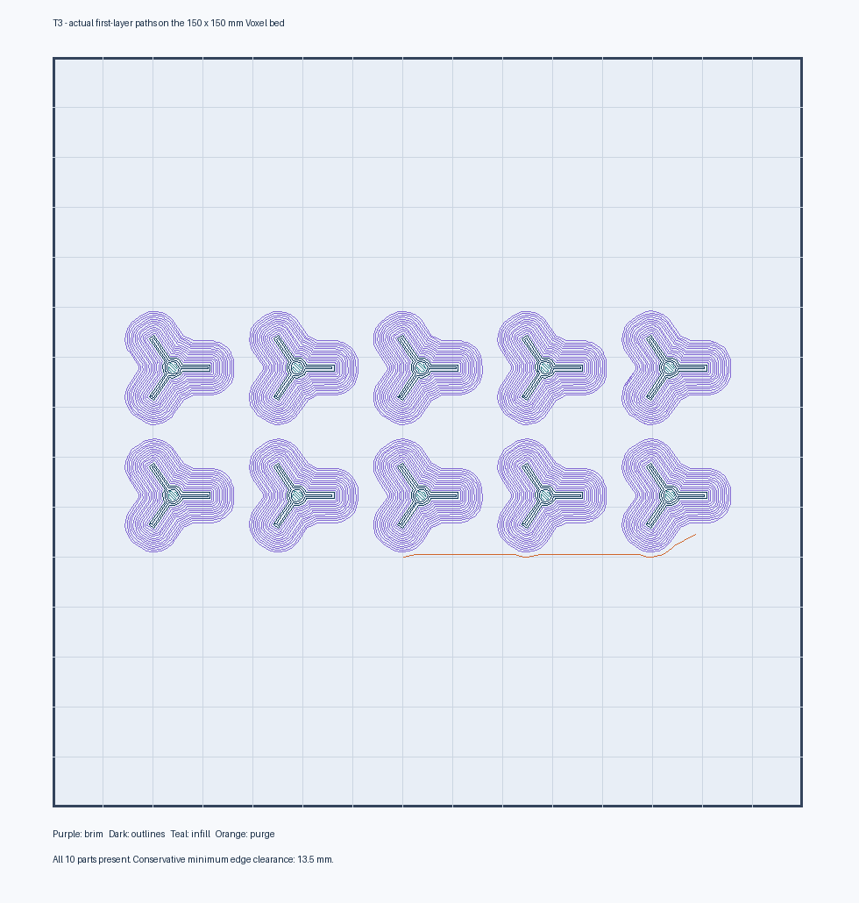

# T3 — cage-section hubs with the selected T1B #2 socket

Prepared **2026-10-09** from the user's T1B results: **rod socket #2 = 1.275 mm drawn bore**, and **M2 pilot #5 = 2.00 mm drawn diameter** on the combined seven-hole strip (coupon identity confirmed by the user). These are coupon CAD dimensions, not caliper measurements. T3 contains no screw pilots; the M2 selection is applied to screw-pilot parts in the current P1B CAD, with physical thread retention still to be qualified.

**Load [T3_cage_section_socket_2_checked.stl](T3_cage_section_socket_2_checked.stl).** Use this checked, centered file for T3. The raw `plates_p1b` layouts are intermediate exports and require separate brim placement checks.

This file contains **ten plain three-way hubs**, centered in **two rows of five**. It uses the exact existing native Fusion hub generator with `rod_bore_clear` changed to **0.1375 mm per side** against the 1.00 mm rod baseline. Bore depth remains **5 mm**; outside hub geometry and arm directions are retained. Nine hubs form the section and one is spare. The complete P1B assembly and its production exports now use the selected fits. T3 still needs the physical section tests below before printing the cage batches.

## FlashPrint settings

Printer **Voxel**, profile **Voxel PETG T3 socket 2 FINAL**. This additional profile is saved in the FlashPrint profile folder and backed up here; Qt readback verifies a 10 mm/s first-layer maximum and 25% brim speed. The older starter remains available. If the new name does not appear in an already-open printing dialog, reopen the dialog or import the `.profile` from `profiles/`.

| Setting | T3 |
| --- | --- |
| Scale / orientation | **100%; supplied flat faces down; keep layout** |
| Layer height | **0.15 mm** |
| First-layer height | **0.27 mm** |
| Perimeter shells | **3** |
| Top / bottom solid layers | **5 / 5** |
| Infill | **25%, Hexagon** |
| Print speed | **35 mm/s** |
| First-layer maximum | **10 mm/s** |
| Travel speed | **100 mm/s** |
| Nozzle | Successful T1B temperature; starter **235 °C** |
| Bed | **60 °C** |
| Retraction length / speed | Successful T1B values; starter **1.5 mm / 30 mm/s** |
| Cooling | Off until **0.6 mm**, then on |
| Brim | **On, 5 mm, one layer, 25% speed** |
| Supports / raft | **Off / off** |
| Dimension / XY compensation | **Off** |

Use the successful bed preparation and thin glue coat. Slice in FlashPrint and confirm ten hubs with the entire brim and purge inside the bed. Watch first-layer adhesion. FlashPrint supplies the actual time estimate; earlier 20–35 minute estimates did not verify this revised slow-brim layout.

## Verification

Native geometry probes confirm three open 1.275 mm bores. The earlier 1.30 mm candidate was reduced to 1.275 mm; this refreshed export matches the current production hub and retains its outside shape. The actual STL is watertight and consistently wound, with ten separate flat solids, no intersections and positive bed contact. Mesh socket probes confirm open paths, intact rims and blind floors.

Footprint **112.30 × 39.12 mm**, height **5.48 mm**; 12 mm gaps leave room for separate 5 mm brims. Offline FlashPrint slicing produces ten first-layer parts and 36 layers. All 51,204 depositing segments, including brim and purge, fit the **150 × 150 mm** bed with at least **13.48 mm** conservative clearance.



The offline `.g` file in `cad/kit/reports` uses generic startup and is **diagnostic only**. Generate the actual job by slicing the STL in FlashPrint with Voxel selected.

## After printing

1. Cool the bed, remove the hubs and trim brims and loose strings. Do not drill or ream sockets larger: that changes the selected fit.
2. Check a carbon rod in each arm of one hub. It must seat with finger pressure and retain firmly without cracking. The actual angled hub sockets need checking even though the straight coupon fitted.
3. Cut **10 edge rods to 44.50 mm** using the original T1 jig. Build **one hexagon and one pentagon sharing an edge**, using nine hubs. Keep flat hub faces outward; the two arms 108° apart belong to the pentagon. Assemble dry, without glue.
4. Follow the [T3 section test](../PRINT_AND_TEST_PLAN.md#t3--cage-section-test-after-the-cad-is-updated-with-t1): 300 g pull-out for one minute, sag under 100 g below 3 mm with full recovery, then five 30 cm drops without damage. The optional 50 cm drop records margin.
5. Report socket fit, pull-out, sag and damage. T3 qualifies section retention and strength before the main cage batch.

## Evidence and reproduction

- [Selected fit results](../fit_results.json)
- [Native Fusion hub checks](T3_native_hub_manifest.json)
- [Checked print manifest](T3_checked_manifest.json)
- [Slice report](../../kit/reports/t3-slice-check-2026-10-09.json)

Run `cad/kit/export_t3_fusion.py` through Fusion with the P1B design active to recreate the temporary native hub; it writes local files without modifying the design. Then, from the project root:

```sh
cad/kit/.venv/bin/python cad/kit/prepare_t3.py
python3 cad/kit/slice_t3_check.py
```
