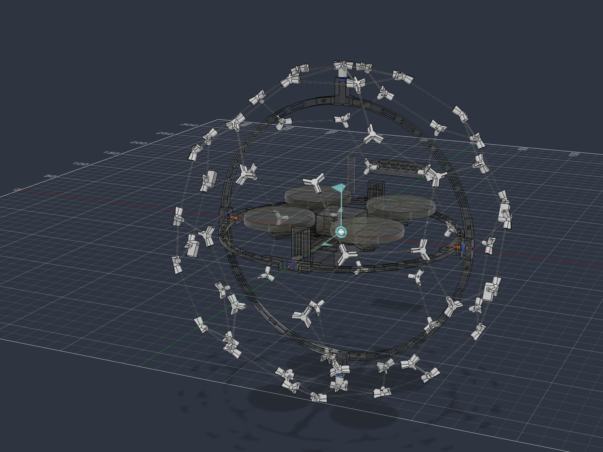
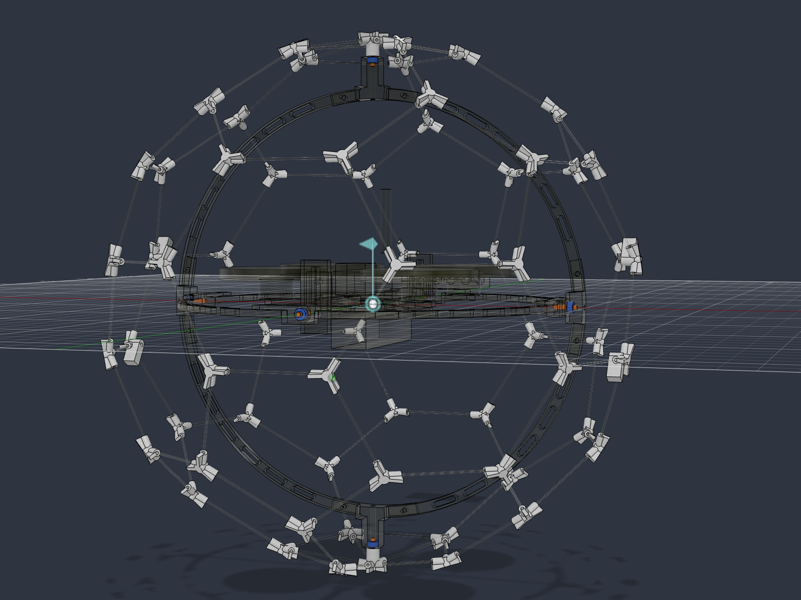

# Fusion CAD review and generator fixes — 2026-10-08

Project: **HackPHS Ball Drone**. Baseline: **P1A v15 / P1B v14**, both open and clean. Final saved versions: **P1A v18 / P1B v17**, both clean, cloud processing complete. The [saved version record](saved-versions.json) and [before/after inventories](inventory-comparison.json) confirm this.

**CAD corrections and nominal geometric review are complete. Physical manufacturing/flight acceptance is not complete.** The user supplied a review-and-fix objective; all solid changes were made in the generators and regenerated. No hand-edited Fusion solid was retained. The source is solely kert's Thingiverse 408519 design; supplied photographs are reference material, not dimension/acceptance evidence. Original archives and the 2026-10-07 review remain intact.

## Confirmed issues and fixes

| ID | Severity | Evidence | Root cause/location | Fix | Verification result | Changed files |
| --- | --- | --- | --- | --- | --- | --- |
| F01 | Blocks reliable assembly / full print approval | P1B nuts intersect foam pad by **24.529076 mm³** at each ±2 mm X frame-slot endpoint; centered overlap 0 | `build_p1a.py:277`: pad omitted moving-nut travel. P1B sweep moved pad and nuts together, missing their relative motion | Derive pad width with lateral frame travel: **19.881 → 15.881 mm**, without reducing travel | Old pad reconstructed: same 24.529076 mm³, rejected. New pad: 0 overlap at −2/0/+2 mm, ≥0.50 mm gap. 3 mm unauthorized travel is rejected | `build_p1a.py`, new `validation.py`, CAD docs |
| F02 | Blocks trustworthy mass use | P1A hidden reference meshes **13.8214 g**, fixtures **12.0906 g**; P1B coupon **11.0886 g** counted in native mass | `build_p1a.py:650`: material loop omitted imported meshes and aircraft-external fixtures | Assign near-zero-density analysis material to imported copies and fixtures; preserve PETG print-volume estimates | Native root **66.6399 → 40.7289 g** P1A; **78.7040 → 67.6154 g** P1B. Analysis residue <0.002 g; original meshes/files untouched | `build_p1a.py`, `validation.py`, CAD docs |
| F03 | Blocks dependable CAD acceptance | Reports could show collisions/connection failures and continue exporting; press engagement used minimum distance on overlapping solids | `build_p1b.py:680,700`, shared Boolean helpers; collision sampling did not give the actual continuous local reserves | Raise on failed geometry gates; prove pin engagement by Boolean volume; add continuous radial/face containment and separate nut/pad checks | 612 sweep cases: 0 collisions. Continuous prop/inner reserve **4.389 mm**; inner/outer **0.321 mm**, outer/cage **0.359 mm**. Six 1.837832 mm³ press fits; eight joint-drive configurations pass | Both generators, `validation.py` |
| F04 | Blocks a mass-ceiling/flight claim | “Within 175 g” / “all-up upper bound” excluded unweighed items. P1B/1100 accounted value **165.25 g** leaves only **9.75 g**. +10 g = **175.25 g** | Mass-report labels; P1B also ignored measured bare-aircraft/thrust override keys | Report accounted scenarios and headroom; reject accounted mass alone above 175 g; honor measured overrides; qualify hardware allowances | Four accounted estimates below 175 g. **Actual mass and thrust remain unverified**, including an alternate solid-bearing scenario around 166.0 g for P1B/1100 | Both generators, CAD README, decision log |
| F05 | Blocks correct printing if an export is missing | Deliberately missing P1B carrier silently selected **P1A's different carrier**. Actual current export set was complete | `make_plates.py:82`: cross-design fallback; no provenance/file-set gate | Use only selected design folder; require generator hashes/file set, mesh closure and finite data; record plate rotations/counts; reject stale files | Missing P1B export now raises; open triangle rejected. **31** part/plate files pass; max XY plate width **137.900 mm**, on Z=0, max height16 mm | Both generators' export path, `make_plates.py`, manifests |
| F06 | Documentation / fit-label defect | README retained v7 blocking status, P1B carrier **4.6 g** vs actual **6.12 g**, outdated axes/masses, and nominal positive bearing allowance called a press fit | CAD README and `build_p1b.py:46,83`; persistent parameter comments did not refresh themselves | Refresh generator-owned fit comments; distinguish 5.05/5.00 mm clearance from physical retention; update status, tables, assembly directions and physical limits | Parameter **values unchanged**. P1B comments now describe actual nominal fit. Cut/deeper-seat, rod bonding and camera tilt remain deferred | `build_p1b.py`, CAD/docs READMEs and maintained CAD/build/mechanical docs |

### F01 hypothesis and proof

The centered screen did not reveal the pad fault. Hypothesis: frame-mounted nuts move laterally while the pad remains fixed to the carrier. Temporary BRep copies translated only the nuts by ±2 mm. Both extremes intersected the existing pad by 24.529076 mm³. This establishes the fault independently of appearance or a renderer.

[Baseline diagnosis](diagnosis-before-p1b.json), [post-fix diagnosis](diagnosis-after-p1b.json), [regression proof](regression-results.json), [diagnostic script](diagnose.py) and [new gates](../validation.py) reproduce the finding. P1A's fore-aft frame travel does not create this collision; its pad stayed unchanged.

Several custom-graphics close-up capture attempts produced uniform-color frames. They are retained as **unusable captures** and are not evidence of a collision or its resolution. Valid native model screenshots support model identification; BRep measurements establish the findings.

## Checks that passed

| Requirement / check | Result and limit |
| --- | --- |
| Outside span | **245.991 × 243.207 × 248.000 mm** XYZ; maximum 248.000 mm. P1B cage enclosing radial diameter ≤248.480 mm also bounds arbitrary orientation |
| Cage topology | **62 hubs, 90 edge rod solids +10 pole rod solids**, 1 mm nominal rod diameter; edge cuts44.53 mm, pole cuts37.86 mm |
| Inventory | P1A77 / P1B97 occurrences before and after; no parameter value changes; healthy timelines; no unexpected extra/legacy top-level assembly |
| Static | P1A75 selected bodies: zero unexpected intersections; P1B103: only six intended pin press fits |
| Continuous P1A prop clearance | All allowed ±4 X / ±5 Y positions: ≥34.632 mm conservative sphere reserve to cage; every support boundary stays outside expanded prop boxes, ≥7.400 mm separating-axis reserve |
| Continuous P1B prop clearance | Allowed ±2 X / ±3 Y / ±5 Z: conservative prop sphere79.611 mm, printed inner minimum84 mm, **4.389 mm** reserve; support boundaries remain outside expanded prop boxes, ≥2.512 mm separating-axis reserve |
| Full printed-ring rotation | Inner printed structure radial maximum91.429 mm vs outer minimum91.750; outer maximum113.145 vs cage minimum113.504 mm. Origin-centred rotations preserve these bounds |
| Discrete motion | 612 relative-motion collision checks include all eight travel corners; 0 hits. Coaxial hardware is excluded from radial bounds and checked independently |
| Connectivity | Eight junctions contact two quarters each; six pins press into their matching parts, pass through their corresponding bearings; bearing shoulders seated |
| Native kinematics | Cage grounded, four rigid groups including cage, three origin-centred revolute joints along Z/X/Y; eight drive cases, connectivity and interference pass, angles reset0°. [Evidence](joint-drive.json) |
| Camera | At provisional20° tilt, nominal ring centreline clear. Thin0.02 mm ray intersections block **8/324 joint-angle pairs (2.47%)**. This is a grid fraction, not flight-time probability or percent of visible image. Wide160° cone remains an approximation |
| Battery/nuts | Both pack boxes tested separately at frame-slot endpoints. 1100 gap0.400 mm; P1B450 minimum0.467 mm. Foam/nut gap≥0.500 mm after correction |
| Materials | PETG1.27 g/cm³, rod proxy1.55, 304 pins, 440C density proxy for bearing placeholder; imported reference copies, fixtures and analysis use near-zero density |
| Meshes / printing | 23 part STLs +8 plate STLs: finite vertices, closed/manifold edge incidence, consistent winding, positive volumes. All print plates within140 ×140, Z=0, heights≤16.0 mm. Exported printable bodies each have one native lump |
| Native/export agreement | Maximum native-size difference **0.003177 mm** and volume discrepancy **0.0945%**, consistent with tessellation. No foreign/stale file remains in the selected export/plate set |
| Print orientation | Manifest transformations match the stated orientation: quarter rings flat, junctions face-down, pivot-block boss vertical, brackets on their flat face, hubs/arms/carrier/coupons on their designated base. Brim/support/toolpath and layer performance still require slicer/physical review |

**Continuous scope:** rigid modeled solids and the declared balancing ranges. Wire/strap geometry, arbitrary battery sliding range, actual-frame details, flex and print deviations are not modeled sufficiently to certify them. Coaxial pins/bearings retain intended contact rather than requiring disjoint radial spheres.

## Accounted mass and thrust scenarios

Bare-aircraft vendor sum44.78 g; pack listing masses26/48 g. PETG is solid-volume scenario; hardware is an unweighed allowance. T:W uses thrust in gram-force and mass in grams.

| Build | Accounted mass | At350 g planning thrust | At280–400 g estimate | Headroom to175 g |
| --- | --- | --- | --- | --- |
| P1A450 |115.51 g |3.03 |2.42–3.46 |59.49 g |
| P1A1100 |137.51 g |2.55 |2.04–2.91 |37.49 g |
| P1B450 |143.25 g |2.44 |1.95–2.79 |31.75 g |
| P1B1100 |165.25 g |2.12 |1.69–2.42 |**9.75 g** |

These are not measured all-up masses or total upper bounds. The0.20 g/bearing allowance differs from the solid modeled steel ring's approximately0.32 g; using the solid hardware geometry gives about166.0 g P1B1100 before other extras. Actual bearing construction has voids and must be weighed. Antenna, connector/wiring differences, strap/foam, adhesives, washers/nuts and tolerances remain uncertain. The actual **≤175 g** condition and actual thrust-to-weight are open.

## Unverified conditions, open decisions and next physical tests

1. **Print/assembly:** measure real frame/motor/prop/camera, both pack types, bearings, pins, rods and fastener stacks. Print socket and gimbal coupons; choose fit and retention from the actual printer. The5.05 mm seat is nominal clearance, not proof of pressing. Qualify bearings' axial retention and pin engagement.
2. **Running gaps and strength:** local0.321/0.359 mm radial reserves need actual print-fit and loaded ring/cage checks. Test representative **1 mm** rod/hub joints and ring/splice sections for bending, buckling, pullout and residual deflection at recorded loads. Tensile strength alone is insufficient. Adjust only from test evidence and regenerate.
3. **Battery/strap/wires:** no complete strap or flexible wire route exists in the CAD. Verify the2 mm provisional strap thickness versus2.5 mm slots, closure/retention, battery removal, cable slack/strain relief, camera bracket and inflow/outflow through all motions. Define any additional permitted battery slide range, model it and repeat the sweep. Select the screw/washer stack and keep modeled nut/tail reach≤2.6 mm, or revise the pad/envelope and CG from measurements.
4. **Weight/thrust:** weigh the defined bare aircraft, every delivered pack, printed structure, actual pins/bearings/fasteners and remaining extras. Weigh the complete build with each pack against175 g. Measure total static thrust on the actual Specter/Gemfan2015/2S setup at recorded voltage; do not adopt the planning estimate as a test result.
5. **CG and camera:** physically balance all three coordinates for each pack; the3.58 mm larger-pack height shift is an estimate. Resolve the deferred camera tilt and repeat optics/clearance checks. The current20° position and14 mm body are placeholders; the actual bracket/wires can enlarge the envelope.
6. **Physical sequence:** build and qualify P1A first: ten consecutive low-energy contacts without damage/prop strikes, ≥3 minutes usable caged flight and repeatable manual recovery. Keep it working. Adopt P1B only after this gate. Validate external-object protection using actual obstacle/probe dimensions; absence of self-collision does not establish cage protection.

**Deferred by the user:** 10.5 mm cutting versus revised seats for full16 mm pins; dry fit versus bonded rod joints; final camera tilt. No choice was made for the user. Pico audio/toImplement remains deferred; yaw-only assistance, the manual/live-tracking fallback and simulator scope are unchanged.

## Before/after source SHA-256

| File | Baseline SHA-256 | Final SHA-256 |
| --- | --- | --- |
| `build_p1a.py` | `657314b53bcd685e6b43a50b89e4e0ef6d936098206669c4682e532e92a7a712` | `0fa963ad26ad83e29f31411eb00ee2d7683a44a28634fdd9dbafbbf6b1c2a682` |
| `build_p1b.py` | `479f3f4435e72b4106aba83ca8a3994a6663b10e50a7ca24b8fdf668111aba10` | `95a2825c007bf92c622ca5fe9f14471cd53053c162bb34e5fbcfab7e7ec049bf` |
| `validation.py` | `new file` | `3f495136590ab032409955d79dea603a3029a7c9ee7cf103c260e79837e0f28e` |
| `vendor_specs.json` | `a324caf1a4e81e26ff2fc18afbb49890d4c51ae427a5b69928f0012d66265986` | `a324caf1a4e81e26ff2fc18afbb49890d4c51ae427a5b69928f0012d66265986` |
| `measurements.json` | `9f94d8cf92e8084bab96ead087fd812b770bc494945cef18a0ed8dbf0180e043` | `9f94d8cf92e8084bab96ead087fd812b770bc494945cef18a0ed8dbf0180e043` |
| `make_plates.py` | `0a019b77b0f7aa57ac566a6f4ee203eee4dd48561a2da4c8f29d312ef116ae3e` | `630943769e2341126be99dd2dd9949bee3672f04cc56e153f3f7f0eb82ffc22a` |

`validation.py` is new. JSON inputs are unchanged and every physical measurement remains null. Baseline source copies are in [baseline-sources](baseline-sources/); [source-before](source-before.json) and [source-after](source-after.json) are machine-readable. Regeneration reports for [P1A before](generator-before-p1a.txt), [P1B before](generator-before-p1b.txt), [P1A after](generator-after-p1a.txt) and [P1B after](generator-after-p1b.txt) are preserved.

## Evidence / reproducibility

- [Final P1A gates](validation-p1a.json), [final P1B gates](validation-p1b.json), [inventory comparison](inventory-comparison.json), [saved versions](saved-versions.json).
- Full occurrences, bodies, transforms, parameters, joints, rigid membership and materials: [P1A before](inventory-before-p1a.json), [P1B before](inventory-before-p1b.json), [P1A after](inventory-after-p1a.json), [P1B after](inventory-after-p1b.json). Baseline joint/rigid membership is additionally in the diagnosis JSON.
- [Static/material/fit diagnosis before P1B](diagnosis-before-p1b.json), [before P1A](diagnosis-before-p1a.json), [after P1B](diagnosis-after-p1b.json); [camera ray intersections](camera-exact-before.json). Camera geometry was unchanged by the pad fix; the final generator repeats its324-pair optics grid.
- [Joint drive](joint-drive.json), [pad/travel regressions](regression-results.json), [plate/source/mesh regressions](plate-regression-results.json), [export audit](export-audit.json), [audit script](audit_exports.py), [diagnosis script](diagnose.py), [joint script](drive_joints.py), [regression script](regression_checks.py).
- Generator manifests: [P1A](../exports/manifest.json), [P1B](../exports_p1b/manifest.json). Plate source/orientation/count manifests: [P1A](../plates/manifest.json), [P1B](../plates_p1b/manifest.json).

A conservative whole-body support bounding-box check was rejected during implementation because an L-shaped flange made the box contain empty space. It was replaced by the stronger face-boundary proof and re-run. No solid was changed to satisfy that false alarm. Mesh auditing does not prove absence of geometric self-intersection, toolpath quality, overhang performance, layer adhesion, strength or actual fit. Native screenshots identify geometry; unusable custom-graphics frames establish no result.
