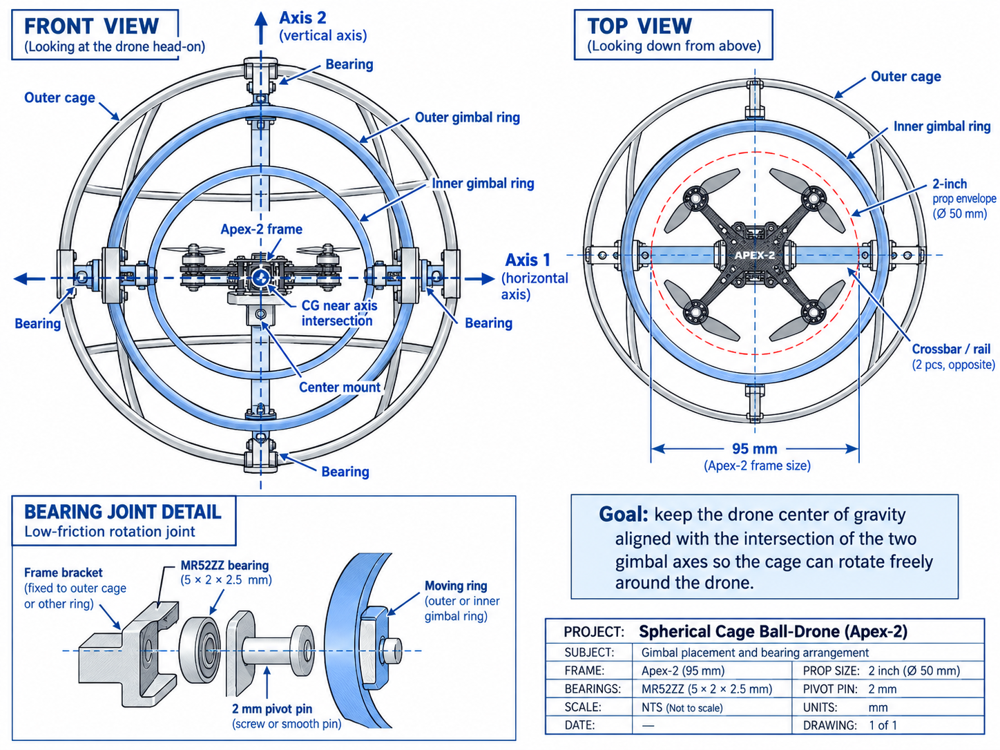
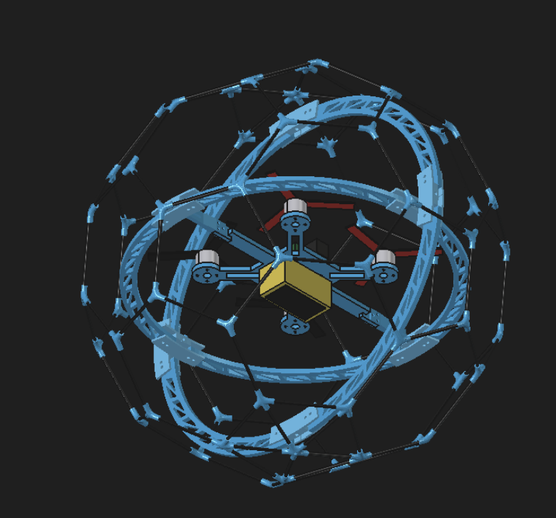

# CAD — Apex-2 cage and removable gimbal

**Final digital package — 2026-10-09:** the [print-ready P1B package](../cad/apex2-cage/print_ready_p1b/README.md) supplies all fourteen production part designs, 84 parts on seven centered production plates, plus T3 and four fixtures with verified saved profiles. Selected T1B #2 rods (1.275 mm), #5 M2 pilots (2.00 mm) and T2 bearing/pin fits are applied throughout the saved native Fusion model. All plates pass brim/purge bed checks; sixteen ring-splice screw axes, six pin seats and six bearing seats pass. Ideal local radial reserves are now 0.86–0.91 mm with a 1 mm running gap and 11.00 mm cut pins. Physical retention, actual-frame dimensions, hardware-head/wire/strap clearances, load strength and flight remain pending. Coupon fits are user reports, not caliper measurements.

**Earlier CAD evidence — 2026-10-08 (superseded fits and local running reserves):** Both vendor/provisional Fusion designs were regenerated and reviewed. See [the CAD checks and current estimates](../cad/apex2-cage/README.md) and [the geometric review/evidence](../cad/apex2-cage/review-2026-10-08/README.md). P1B frame-slot travel now clears its foam pad; nominal rigid prop checks pass. Local pivot-region reserves are only 0.32–0.36 mm, and the 1100 mAh P1B accounted estimate leaves 9.75 g for unweighed items. Strap/wire routing, battery service access, printed fits, loaded clearance, strength, actual weight and thrust remain pending. The user requested P1B CAD ahead of the fixed-cage gate; that gate still controls physical P1B adoption.

Source: Google Doc **CAD**, read 2026-10-07. [Source snapshot and images](sources/google-doc-2026-10-07/03-cad.md). Additional sources: user-supplied Thingiverse ZIPs and mechanical printing brief, inspected 2026-10-07; see [the adapted mechanical brief](17-mechanical-cad-brief.md).

## Geometry baseline

Use [Thingiverse 408519](https://www.thingiverse.com/thing:408519) as the cage/gimbal reference. Adapt the outer cage to a **245–250 mm diameter target** and replace the reference center with the current **Apex-2, approximately 95 mm wheelbase, 2-inch-prop aircraft**.

Scale the overall geometry deliberately. Rod sockets, bearing seats, pivot bores, fasteners, motor mounts and battery interfaces must fit measured purchased parts; uniform scaling would change these interfaces.

The [CAD workspace](../cad/README.md) contains planning guidance and an [unmodified upstream reference package](../cad/references/thingiverse-408519/README.md). Reference STLs are not adapted project models. No measured Apex-2 manufacturing model exists yet. Complete parametric CAD for the P1A fixed cage and a separate P1B two-ring gimbal design (hubs, rods, carrier, supports, rings, pivots, antenna mount, fit coupons, rod jig and print plates) is in [cad/apex2-cage](../cad/apex2-cage/README.md). It uses vendor-spec and provisional dimensions; caliper measurements, fit coupons and a thrust test are still pending.

## Two build configurations

| Configuration | Design obligation |
| --- | --- |
| P1A fixed cage | Protective outer cage, fixed center mount, adjustable aircraft/battery position and clear prop/camera envelopes |
| P1B removable gimbal | Two lightweight rings, bearings and pivots that reuse the P1A aircraft and permit free cage motion |

**Only P1B is built (user decision, 2026-10-08).** P1A remains in CAD as a reference and is not printed or flown. P1B itself must pass ten consecutive low-energy contacts without damage or prop strikes, at least three minutes usable caged flight and repeatable manual recovery before demo use; there is no fixed-cage fallback. Locking the rings with zip ties is the fallback configuration. Retain X/Y adjustment for quad and battery balance; measure and explicitly bound any battery sliding range before claiming a complete sweep. For P1B, also measure the vertical center-of-gravity offset relative to the gimbal axes: X/Y adjustment alone cannot align all three coordinates. Decide the required axis/carrier height or vertical adjustment from those measurements and verify balance and free movement for every pack used.

## Proposed assembly and CAD parameters

The **upstream reference is only kert’s original Thingiverse 408519 design**, preserved in the two supplied ZIPs. Its README and assembly photo show a truncated-icosahedral rod cage, printed hubs and two perpendicular quarter-segment hoops around a different aircraft center. Part 1 contains 18 STL meshes; part 2 contains additional images. We have inventoried mesh extents, not verified hardware fits or a cage scale factor. Neither Wasim’s simulator nor the Google Doc illustrations are upstream CAD. See [reference provenance, original license and mesh inventory](../cad/references/thingiverse-408519/README.md).

| Assembly | Proposed implementation |
| --- | --- |
| Outer cage | Parameterize overall outside diameter within 245–250 mm. Adjust cage member lengths and hub directions deliberately; recreate measured hardware interfaces rather than scaling their holes. |
| Aircraft carrier | Mount the Apex-2 to one carrier with X/Y adjustment. Keep the camera, AIO, wiring and battery attached to the aircraft assembly. |
| Battery mounting | Strap slots and an adjustable support surface sized from measured 450 mAh packs and the two user-reported 1100 mAh candidates; check strap access, retention and battery removal. The 1100 mAh packs exceed the frame seller's 650 mAh recommendation and require mass/CG/thrust validation before flight. |
| P1A fixed supports | Removable supports join the carrier to cage attachment points; omit gimbal rings from the first flight configuration. |
| P1B gimbal kit | Replace the fixed supports with outer/inner rings, bearing blocks and pivots that reuse the carrier and cage attachment interfaces. Retain the fixed supports for recovery to P1A. |
| Clearance geometry | Represent all four full prop disks, the aircraft body, wire slack and useful camera view. Sweep relative cage/ring/aircraft motion through every mechanically reachable position. |
| Mass tracking | Record estimated material volumes/masses for hubs, rods, supports, rings, bearings, pins and fasteners; maintain separate P1A/P1B totals. |

Parameters must include actual motor-center coordinates, prop radius, rod diameters, bearing OD/ID/width, pivot dimensions, battery envelopes and required adjustment travel. The frame wheelbase alone does not define the aircraft envelope.

Define the 245–250 mm target as the maximum assembled outside span and record the minimum inside distance at faces, edges, hubs and supports. The largest outside dimension does not establish an inscribed clearance envelope.

Reserve positive prop clearance for measured tolerances, rod/ring flex and wire motion. Zero intrusion is mandatory; tangency in the nominal model is not an adequate clearance result. Set the allowance from measured fits and observed flex rather than inventing a verified millimeter margin. If a reachable pose collides, revise the geometry or define and validate mechanical travel stops before printing.

P1A and P1B share the cage, hubs and carrier interfaces, but only P1B is fabricated. Its swept-clearance and mass review is done in vendor/provisional CAD. Print the fit coupons before the rings, then verify every reachable pose physically.

## Source concept drawing

This is a **not-to-scale reference illustration**, not a dimensioned manufacturing drawing. Its MR52ZZ bearing annotation is 5 × 2 × 2.5 mm and its pivot annotation is 2 mm; verify the actual purchased bearing/pin dimensions and fit. Its “2-inch” prop annotation rounds to 50 mm; use the actual measured propeller diameter when constructing the swept envelope. Its 95 mm label identifies the frame concept and must not be treated as the full propeller/aircraft footprint.

The older reference model supplies topology and assembly ideas. Its center geometry does not establish fit for the Apex-2.

## Modeling and printing sequence

1. Measure frame, motor centers, prop diameters, camera/lens, battery range, AIO stack, wiring, bearings, pivots and rods.
2. Build an aircraft envelope, including each complete prop disk and wiring sweep.
3. Design the cage, gimbal rings and adjustable center mount (P1B).
4. Check prop clearance, camera field of view, airflow, battery removal and center-of-mass adjustment.
5. Estimate and then weigh cage/mount parts; compare against the thrust/endurance budget.
6. Print small fit coupons for rod sockets, bearing seats and pivots before the complete assembly.
7. Build P1B. Recommended: fly the first hovers with the rings zip-tied, then free them.
8. Keep the full reachable gimbal motion checked against every prop disk, wire envelope, camera view and mass estimate (done in CAD on 2026-10-08; repeat after measurement changes). Fly P1B against the contact/endurance/recovery gate.

No cage member, ring or wire may intrude into a prop disk at any reachable configuration. Include flex observed during contact tests; a static screenshot alone is insufficient.

## Review conditions before a full print batch

- Establish an added-structure mass allowance from measured bare-aircraft/pack masses and thrust; use [the mass worksheet](17-mechanical-cad-brief.md#measured-mass-budget).
- The ordered Amazon rod listing provides diameter/length but no engineering strength or modulus data. The Thingiverse reference uses 3 mm rods. Treat 1 mm as a prototype baseline only, then test representative planned-length rod/hub/connector assemblies for load-direction deflection, retention and joint slip. Record the load and require observed deflection to stay within the measured prop-clearance budget; reinforce locally with 1.5 mm only from those results. See [CAD reference research](19-cad-reference-research.md#structural-question-is-1-mm-rod-enough).
- Define intended contact objects and check whether their edges can enter cage openings and reach a prop before the cage intercepts them. Zero self-interference does not prove protection from an external object.
- Record repeatable contact conditions and per-contact inspection; see [the acceptance record](10-build-and-test.md#repeatable-contact-protocol).
- Separate removable service joints from any deliberately bonded rod/hub subassemblies. If bonding is selected, record what becomes a replaceable unit; do not claim every glued component can be disassembled individually.

[Mechanical review](18-mechanical-review.md) records the findings and remaining evidence.

[CAD reference research](19-cad-reference-research.md) compares the closest public gimbal/cage projects, source files and reuse limits. The Thingiverse 408519 archive remains the sole upstream CAD reference.

## Monoprice Voxel printability

The supplied brief specifies a 150 × 150 × 150 mm Voxel, 0.4 mm nozzle and 1.75 mm PETG. Print hubs, connectors, adjustable mounts and any printed cage/ring members as replaceable modules that fit the usable volume with orientation, brim/supports and margin accounted for. Avoid diagonal-only bed fits. A 245–250 mm cage is an assembly, not a single print; future rings also need segmentation whenever their actual print envelope exceeds the usable area.

The reference already supplies segmented hoops, but some original meshes exceed a 150 mm axis if imported as millimeters. Confirm STL units and redesign interfaces/segmentation rather than printing the originals unchanged. Preserve both `DO_NOT_PRINT_…` files as reference-only.

Use PETG for prototype printed structural parts while retaining the established 1 mm carbon-rod baseline. The upstream design used 3 mm rods; its sockets and rod cut list must not be copied as current specifications. Any all-PETG-member alternative requires a separate mass/stiffness comparison.

For prototype profile ranges, fit coupons, layer orientation, mechanical joints, print/BOM deliverables and mass calculation, follow [the mechanical CAD and printing brief](17-mechanical-cad-brief.md). All settings remain untested until measured on the actual printer.

## Material and assembly rules

- Start with 1 mm rods; reinforce with 1.5 mm only where testing demonstrates excessive flex.
- Minimize printed hub/TPU volume. The BOM lists PETG; select print settings/material use from actual fit, stiffness, mass and available equipment.
- Keep camera field of view and propeller inflow/outflow clear.
- Use a strap-style battery mount. Size the support from the actual 450 mAh packs and assess the two 1100 mAh packs using their measured dimensions and masses. The frame seller recommends up to 650 mAh; 1100 mAh is not an assumed fit or approved flight configuration.
- Include accessible fastening, wiring strain relief and unobstructed battery replacement.
- Track estimated cage/gimbal mass before printing, then replace estimates with measured values.

Use [hardware arrival](13-hardware-arrival.md) for measurements and [build and test](10-build-and-test.md) for acceptance. Fusion MCP connection instructions are in [16-fusion-mcp.md](16-fusion-mcp.md); successful tool connectivity does not verify a CAD design.

## Sources and verification references — 2026-10-07

<!-- audit-source-footer -->
- [Google Doc — CAD tab](https://docs.google.com/document/d/1QrmGZfF8AJm1gQhVAsY_8FbZmaZgIQHXRB_zzldYWVA/edit?tab=t.ri12fpw0hdp1) — Source snapshot captured 2026-10-07.
- [Thingiverse 408519](https://www.thingiverse.com/thing:408519) — User-designated upstream reference; supplied archive inventory is linked in the CAD workspace.
- [CAD reference research](19-cad-reference-research.md) — Comparative project review, structural caveats and reuse limitations.
- [Apex-2 frame listing](https://speedyfpv.com/products/apex-2-2-inch-95mm-carbon-fiber-drone-frame-kit?variant=46334350164182) — Seller specifications only; measure the actual frame.
- [OVONIC 2S 1100 mAh 60C XT30 two-pack listing](https://us.ovonicshop.com/products/2-ovonic-rebel-2-0-60c-2s-1100mah-lipo-battery-lihv-7-6v-pack-with-xt30-plug-for-size-100mm-to-140mm-brushless-drones-long-range-drone-fpv) — Reference only; vendor dimensions are internally ambiguous, so size the strap mount from measured packs.

The complete current print package is also in [print_now/START_HERE.md](../cad/apex2-cage/print_now/START_HERE.md), with all twelve plates, fourteen replacement designs, matching saved profiles, native model, assembly guide and a downloadable ZIP.
