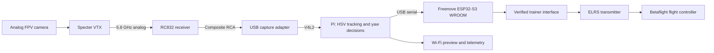

# Software — local vision and verified flight assistance

Source: Google Doc **Software**, read 2026-10-07. [Source snapshot](sources/google-doc-2026-10-07/04-software.md). The user's 2026-10-07 clarifications define the accepted manual fallback and assistance gates.

## Intended architecture

Betaflight owns stabilization, motor control, flight failsafes and normal flying. The passive outer cage needs no custom software. A Raspberry Pi 4/5 runs vision, bounded steering decisions and monitoring locally.

The Wi-Fi preview is secondary and outside the control loop. The pilot retains throttle, roll, pitch, ARM/DISARM and physical override. V1 computer corrections affect yaw only.

## Demo deployment

| Device | Current role |
| --- | --- |
| Raspberry Pi 4/5 in source plan | Local FPV vision/decisions and port-8080 monitoring; existing installers target Pi5 and need actual-device checks |
| Mac | Development, software rehearsal, remote operator workstation and independent port-8765 game |
| Visitor devices | Read-only preview/status and isolated browser-local playback |
| Freenove ESP32-S3 WROOM | User-selected physical flight-bridge board; firmware integration and trainer output remain unimplemented/unverified |

Shared-network and BallDrone-Demo hotspot profiles are prepared. [Runbook](12-demo-runbook.md) supplies startup/network steps; neither prepared profiles nor Mac/container checks establish actual Pi networking/performance.

## Video and vision

Use MEIVIFPV camera → Specter VTX → RC832 → yellow RCA composite → USB capture → Pi. Linux should enumerate the actual capture adapter through V4L2; `/dev/video0` is an example. Confirm format, buffering and disconnect/frozen-frame behavior on the hardware.

The source proposes MJPEG, H.264/GStreamer or WebRTC for monitoring and excludes HLS for this low-latency use. Its **40–150 ms** camera-to-Pi decision latency is an estimate, not a result or acceptance threshold. Measure camera-to-decision and the full physical command response separately.

The existing implementation uses Python, OpenCV, NumPy and pyserial. OpenCV may be replaced if the same tested behavior is retained. V1 tracking uses a bright colored target, HSV conversion, blob detection, target center, horizontal error and a small bounded yaw correction. Target size is display/decision data; pilot controls distance.

## Demo route selection

Physical yaw assistance is preferred only after the complete **ESP32-S3 → trainer → radio → ELRS → FC** path, pilot override, signal-loss handling and failsafes are verified. Otherwise use manual contact/recovery plus live target tracking. Physical yaw assistance is **not required for demo success**.

The manual fallback screen must show live FPV video, a colored-target bounding box, center/error indicator and **“Manual steering — computer steering unavailable”**. Keep simulation footage separate; synthetic motion or simulated yaw is not aircraft telemetry.

[Runbook](12-demo-runbook.md) defines both presentations.

**Implemented 2026-10-08.** The manual-fallback screen is built in the software; it still needs acceptance with real FPV.

- **Browser:** `http://<host>:8080/fallback` is a read-only page.
- **Native app:** **View → Manual fallback view** shows the same content.
- **Content:** the server-drawn target box and centre line on the video, a centre/error indicator, the target state and the status text.
- **Status text:** the server sends **"Manual steering — computer steering unavailable"** as `steering_status`. It stays until a bridge declares verified physical output, and none does.
- **Labelling:** non-camera input is labelled "not live FPV".
- **Stale video:** when frames stop arriving, the screen says *Video stale*. This is tracked separately from the server connection, so an old picture cannot look live.

## Operator safety additions — 2026-10-08

| Behaviour | Detail |
| --- | --- |
| Operator lease | Assistance enabled through the API lapses to FAULT/neutral (*operator connection lost*) if no operator heartbeat arrives for 1.5 s. Browser and native clients send one every 0.3 s while unlocked; recovery never re-enables. |
| Ordered commands | The browser sends operator commands one at a time; a disable cancels any queued enable. **Lock** requests neutral before forgetting the token. |
| Live picture checks | For a camera, a bit-identical repeated picture (frozen capture buffer) or a uniform blank screen for 0.5 s is a source fault. Unplugged cameras are reopened every 1 s; recovery clears the source error but leaves assistance disabled. |
| Target switching | A detection that jumps to a different blob (no candidate near the tracked one) restarts acquisition instead of steering toward it. |
| Settings changes | A detection computed with replaced detector settings is discarded. |
| Worker health | `/api/health` reports `ok` only while both workers run and have ticked in the last 3 s. Logging failures are counted, never fatal to control. |
| Camera start | `ball-demo serve --camera 0` or `--camera /dev/video0` (Video4Linux2 on Linux); `ball-demo cameras` lists openable devices. Recordings play at their own frame rate. |
| Colour picking | Click the target in the live video (browser or native) to set hue/saturation/value thresholds. Red targets that wrap hue 0/179 are reported, not silently clamped. |
| Latency | `ball-demo latency --camera 0 --trigger screen|gpio` times a flashing target to host detection; snapshots also report `decision_ms` (frame capture to control decision). |

## Control and failure rules

- Deliberate operator enable only; startup/restart remains MANUAL, disabled and neutral.
- Clamp and slew-limit ordinary automatic yaw corrections.
- Disable, target loss or fault requests neutral directly; neutral must not wait for ordinary slew limiting.
- Communication/source failures disable assistance. Recovery does not automatically re-enable it.
- Pilot override must remain effective independently of a working vision application.
- Keep Pi vision/control local; visitor connections cannot control the bridge.
- Do not let V1 computer control manage throttle, pitch, roll or ARM/DISARM.

## Existing software foundation

[Software source](../software/README.md) already provides synthetic/recorded/camera adapters, HSV tracking, four states, bounded yaw, mock/USB-serial transports, session logging, a browser monitor and native Qt workstation.

| State | Existing software behavior |
| --- | --- |
| MANUAL | Disabled; requested yaw zero |
| SEARCHING | Deliberately enabled but awaiting acquisition, or target lost; zero yaw |
| LOCKED | Acquired target; bounded yaw correction |
| FAULT | Capture/bridge/freshness failure; disabled and zero |

Quality is a heuristic based on visible blob size/continuity, not a probability of safe flight. A camera host-read timestamp does not prove that the analog receiver delivered a fresh image.

### Existing demonstration defaults

These are software defaults, not calibrated flight gains.

| Setting | Default |
| --- | --- |
| Processing | 640 × 480, target 20 Hz |
| Control / shared preview | 20 Hz / maximum 10 Hz |
| Acquisition | Three consecutive valid detections |
| Missing target | Neutral on first processed missing-target frame |
| Frame / ACK freshness and bridge watchdog | 250 ms; host observes expiry on the next control tick |
| Gain / smoothing / deadband | 700 / 0.35 / 0.04 |
| Max yaw / slew / direction | 650 / 1800 units per second / +1 |
| HSV hue / minimum saturation / value | 35–85 / 100 / 80 |
| Blob area | 100–50000 pixels² |
| Default startup | Synthetic input, mock bridge, MANUAL, disabled |

Capture and control have separate workers; latest-frame delivery does not erase target-loss neutralization. Preview JPEGs are cached/shared. The existing native workstation starts its backend in a separate process. Actual Pi scheduling, capture latency and physical neutralization remain measurements to perform.

### Interface and logs

Public reads include health/state, SSE events, MJPEG preview, cached preview JPEG and isolated sandbox data. Operator writes require a private token and strict request types; invalid or unknown fields are rejected. Visitor trace playback stays local to the browser and cannot mutate the shared bridge.

Ignored runtime storage holds configuration/environment, event JSONL, sample CSV and session summaries. Replay illustrates recorded software behavior and has no physical serial activation path.

## ESP32-S3 bridge status

The user selected a **Freenove ESP32-S3 WROOM** board on 2026-10-10 because the team does not have the previously planned Mega 2560. The board's USB-UART connector can connect directly to a Pi as a serial device; the VIXLW capture adapter remains a separate USB video device. The [Freenove USB guide](https://docs.freenove.com/projects/fnk0085/en/latest/fnk0085/codes/C/35_USB.html) distinguishes its USB-UART and USB-OTG interfaces.

The existing [Arduino Mega sketch](../firmware/README.md#historical-arduino-mega-2560-sketch) and Pico scaffold are historical artifacts. The existing host protocol has not been ported and verified on the ESP32-S3 target.

No ESP32-S3 trainer/GPIO output is implemented or verified. USB enumeration or protocol ACKs would establish serial/internal-state communication only, not trainer output. Preserve the pilot's authority and the physical assistance gates.

The current selected bridge board is **Freenove ESP32-S3 WROOM**. Board-specific firmware, electrical compatibility, pinout, trainer framing, channel mapping and physical authority still need implementation/measurement. Existing software tests do not verify this board. The Pico-specific wireless-audio implementation path remains deferred, while the user's Flutter plan includes two-way audio and ElevenLabs TTS; audio hardware and backend choices are open in [UIDEVPLAN.md](../UIDEVPLAN.md). The `toImplement` source tab remains deferred.

## Build order and acceptance

1. Betaflight/ELRS and stable bare-quad manual flight.
2. Actual FPV capture on Pi and local vision.
3. For the assisted route, implement and verify the Pi/ESP32-S3/trainer/radio path, physical override and watchdog with props removed. An incomplete bridge does not block the accepted manual route.
4. HSV tracking and display; enable airborne yaw only after prior gates pass.
5. P1B gimbal-cage integration and full-demo rehearsals.
6. Optional P2.5 small pitch approach and P3 tags/snapshots only after a reliable core and three clean rehearsals.

Acceptance: override 20/20 props-off then 5/5 airborne checks; neutral on every target-loss check; no sustained tracking oscillation; clamp and slew limiting active; measured complete response latency.

Autonomous toss launch, optical flow, LiDAR, autonomous landing, SLAM, AI object detection and wall climbing are later work. [Priorities](08-future.md) and the 48-hour feature freeze govern additions.

## Navigation implementation — 2026-10-08

The user requested a plan for receiving FPV on the ground Pi and returning steering commands, with an offered Intel depth-camera map. The [navigation plan](20-semi-autonomous-navigation.md) sequences real capture/timing, verified yaw, calibrated AprilTag localization, mapped pilot guidance and optional later automatic movement. [Next-session context](21-navigation-codex-handoff.md) includes a copyable prompt and source map.

The authorized N3/N4 software is implemented: calibration/correction, AprilTags/pose rejection, strict versioned map/survey imports, 3D swept-cage advisory routes, independent localization/planning worker, browser/native operator guidance, observation logging/replay, D435 stationary capture/rebuild and a mock waypoint follower. See the [launch/capture runbook](23-navigation-software.md). Navigation is optional and never writes to the bridge; baseline startup stays disabled/mock. Real error/coverage/timing and physical acceptance remain pending. A scan provides geometry; live localization must establish aircraft pose in that geometry. The current bridge has no verified output, and physical authority remains yaw-only. Roll/pitch/throttle automation is a separate scope decision requiring measured sensing, controller and loss-response gates. MSP override is a research alternative requiring firmware/version and actual transport verification.

The backend also exposes `/api/mission/status` and token-protected mission command/reconciliation routes for the future operator client. Status distinguishes live/mock/recorded video, localization, bridge trust, telemetry and capability readiness. Follow and landing requests are explicitly rejected; stop/abort are not motor stop or disarm and no command reaches aircraft hardware. Inspection missions remain advisory, and a lost surveyed target tag resets arrival before reacquisition. See the [mission/status contract](23-navigation-software.md#backend-mission-commands-and-status).

[Implementation status](11-pre-hardware-status.md) · [Hardware worksheet](13-hardware-arrival.md) · [Desktop](14-desktop-app.md) · [Verification](15-verification.md).

## Sources and verification references — 2026-10-07

<!-- audit-source-footer -->
- [Google Doc — Software tab](https://docs.google.com/document/d/1QrmGZfF8AJm1gQhVAsY_8FbZmaZgIQHXRB_zzldYWVA/edit?tab=t.4nvsq5osusve) — Source snapshot captured 2026-10-07.
- [Software implementation and run guide](../software/README.md) — Current source modules and defaults.
- [OpenCV documentation](https://docs.opencv.org/) — Library reference; hardware capture support remains unverified.
