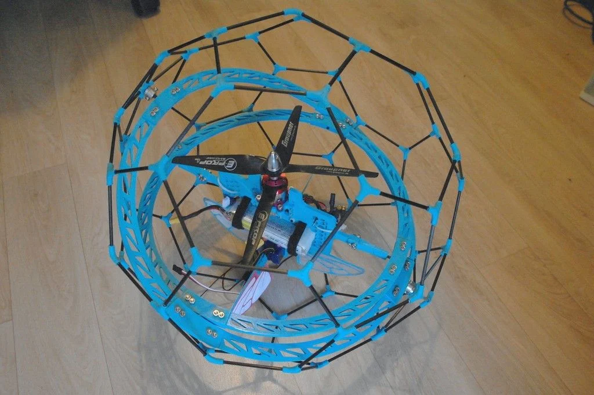
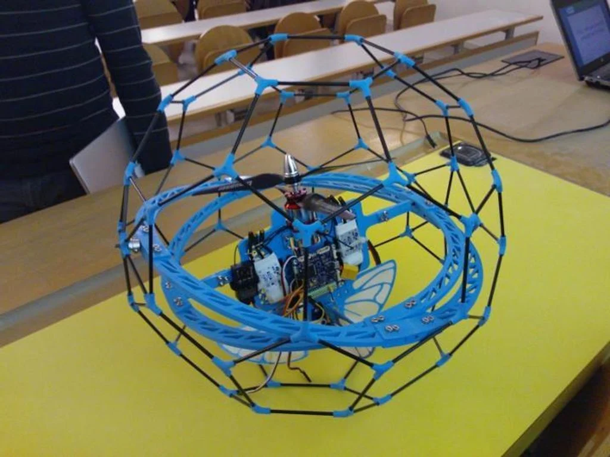

# References and evidence

Source: Google Doc **refs**, read 2026-10-07. [Source snapshot](sources/google-doc-2026-10-07/07-refs.md).

## Design references

- [Thingiverse 408519](https://www.thingiverse.com/thing:408519): cage and two-ring-gimbal topology. Adapt interfaces to measured current components.
- [Current CAD concept and reference images](03-cad.md): Apex-2 concept, bearing/pivot sketch and older model.
- [Current BOM](02-bom.md): source vendor/product links and newer user-reported ordering status.

These photos are **reference examples from the Google Doc**, not photographs of this team's verified Apex-2 build.

## Sources and historical records

| Record | Use |
| --- | --- |
| [Google Doc captured 2026-10-07](sources/google-doc-2026-10-07/README.md) | Current eight adopted source tabs, full tab metadata, tables, links and five embedded images |
| Ninth tab, `toImplement` | Captured for provenance; adoption and Pico audio remain deferred |
| [Google Doc captured 2026-10-04](sources/google-doc-2026-10-04/README.md) | Earlier source, including the old Further Improvement / Feedback tab |
| [Local docs before rewrite](sources/local-docs-before-rework-2026-10-07/README.md) | Preserved descriptions of the earlier 85 mm/Pico software baseline |
| [Decisions](decisions.md) | Historical changes and the user's current clarifications |

New source requirements supersede old planned hardware descriptions. Saved test evidence retains its original date, configuration and scope.

## What to save for judging

Keep manufacturer/vendor pages or dated screenshots for specifications used in the presentation. Source vendor prices, stock, delivery and component claims have not been independently rechecked during this documentation rewrite.

Save project-generated evidence for measured mass/thrust, battery endurance, complete control latency, override/loss tests, controlled cage contact and successful rehearsal footage. Every result should identify the actual hardware/configuration, date, operator and raw record.

Use [physical build/test](10-build-and-test.md) and [arrival worksheet](13-hardware-arrival.md) for the remaining measurements. [Recorded evidence](../evidence/README.md) and [software verification](15-verification.md) describe existing Mac/container/mock tests; they do not prove ESP32-S3 trainer output or flight.

## Related working references

- [Independent simulation repository](https://github.com/WasimVorvoi/HackPHS) and [local simulation instructions](06-simulation.md).
- [Software README](../software/README.md), [historical firmware](../firmware/README.md) and [protocol](../firmware/PROTOCOL.md).
- [Fusion MCP setup and client prompts](16-fusion-mcp.md).

## Sources and verification references — 2026-10-07

<!-- audit-source-footer -->
- [Google Doc — refs tab](https://docs.google.com/document/d/1QrmGZfF8AJm1gQhVAsY_8FbZmaZgIQHXRB_zzldYWVA/edit?tab=t.76sp9sduf57s) — Source snapshot captured 2026-10-07.
- [Current evidence index](../evidence/README.md) — Saved verification artifacts and limits.
- [CAD reference research](19-cad-reference-research.md) — Relevant original and comparison CAD sources.
