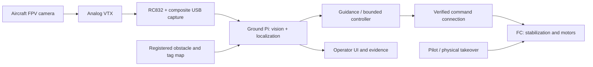

# Semi-autonomous navigation — implementation plan

Updated **2026-10-09**. This document records the earlier mapped-navigation plan. It is **superseded for the active demo** by the [portable visual missions plan](27-portable-visual-missions-plan.md): the demo will use FPV and tags in a controlled, unmapped space, and D435 room mapping will not be done for this project. Keep its existing code and historical implementation evidence; do not treat the D435 steps below as current work. The physical localization/guidance and aircraft output described here remain unverified.

[Next-session handoff](21-navigation-codex-handoff.md) · [Software baseline](04-software.md) · [Hardware worksheet](13-hardware-arrival.md) · [Physical build gates](10-build-and-test.md).

## Goal and scope

Historical goal: receive aircraft FPV video on a **ground-based Raspberry Pi**, process it locally, and return small steering commands through a verified connection. This plan originally used a RealSense D435 room scan and mapped guidance. The user has since decided D435 room mapping will not be done for this project/demo; use the portable visual missions plan for current software priorities.

Current flight scope remains **yaw-only assistance**. The pilot controls throttle, roll, pitch, ARM/DISARM and takeover. Mapped guidance can operate while the pilot flies. Automatic translation or altitude control is a later scope decision requiring additional sensing, controllers and physical failure tests. The implementation authorization does not change physical flight-control authority.

Manual contact/recovery plus live tracking remains accepted demo success. Preserve the physical flight gate on the P1B gimbal build (P1A is not built; user decision, 2026-10-08), the $200 additional-purchase cap with at least $30 reserved, and the 48-hour feature freeze. Optional spending waits for a working core. Pico wireless audio and `toImplement` remain deferred.

## Original baseline and remaining physical gaps

| Source | Implemented | Missing or unverified |
| --- | --- | --- |
| [sources.py](../software/ball_demo/sources.py) | Synthetic, recorded and OpenCV/V4L2 camera input; requests one queued capture frame | Actual device buffering/latency; timestamp is assigned after host read, not camera exposure |
| [vision.py](../software/ball_demo/vision.py) | HSV centroid, bounding box, horizontal error and heuristic quality | Metric range, tags, calibration, room pose and velocity |
| [control.py](../software/ball_demo/control.py) | MANUAL/SEARCHING/LOCKED/FAULT, acquisition, bounded/smoothed/slew-limited yaw, immediate requested-zero on loss | Waypoints, translation and altitude controllers |
| [engine.py](../software/ball_demo/engine.py) | Separate capture/control workers, source/ACK/operator freshness, shared preview and logging | Map, localization and planner; physical telemetry absent and output unavailable |
| [bridge.py](../software/ball_demo/bridge.py) and [protocol](../firmware/PROTOCOL.md) | Mock/USB serial, sessions, sequences, accepted internal yaw | Verified Mega/trainer/radio output; ACK is not aircraft feedback |
| [Firmware](../firmware/README.md) | Portable C parser/watchdog and historical Pico scaffold | Mega sketch, trainer waveform, channel mapping and physical acceptance |
| [latency.py](../software/ball_demo/latency.py) | Flash/LED-to-host-detection tool | Downstream bridge/radio/FC/aircraft response; actual hardware measurements |
| [Simulation](06-simulation.md) | Keyboard flight, illustrative collision world and telemetry display | Uses exact simulated velocity/altitude for movement control; not a physical navigation interface |

Defaults are 20 Hz processing/control, 10 Hz preview, three-frame acquisition and 250 ms frame/ACK/watchdog deadlines. These are software settings, not measured Pi capability, calibrated gains or accepted navigation latency. Capture backends may ignore buffer-size requests. Frozen/blank-picture checks cannot certify actual exposure age.

## Architecture

Video travels to the Pi; commands travel back. Returning video to the aircraft is unnecessary.

The FC retains fast attitude stabilization; the Pi handles perception and slower guidance. Visitor/browser preview stays outside the feedback loop. Keep the Pi and scanning equipment off the aircraft unless another measured mass/power/CG review supports a different arrangement.

### Control-interface options

| Option | Disposition |
| --- | --- |
| **Intended baseline:** Pi USB → Mega → trainer → transmitter → ELRS → FC | Preserve the plan. Verify actual trainer support, connector/pinout, voltage, protocol, timing, mixes, channels, physical override and output watchdog before implementing output. |
| **Research alternative:** selected-channel Betaflight MSP override | Needs supported installed firmware and an actual USB/UART or separately designed wireless connection to the FC. A ground Pi cannot use UART without a transport. Keep arming/takeover with the physical receiver. Not implemented or selected here. |
| **Later platform study:** external-vision/offboard autopilot | PX4 documents this architecture, but compatibility with the current Specter F411 is not established. Not a flashing instruction or a prerequisite for advisory guidance. |

The current official Betaflight MSP guide documents version-dependent loss behavior: 4.5.x/2025.12.x may hold the last override input; 2026.6+ documents receiver fallback after 300 ms. Identify the installed build and bench-test its actual response. Neutral yaw does not brake, hover or land the aircraft. [Official MSP guide](https://betaflight.com/docs/wiki/guides/current/MSP-Companion-Computer-Control)

## Localization recommendation

Start with **surveyed AprilTags in one small mapped zone**, seen through the aircraft FPV camera. This is a proposed experiment, not a demonstrated ability to detect small tags through analog video. Select size/placement from actual tests at the intended range, angle, lighting and motion.

Known tag size and calibrated camera intrinsics support pose estimation. Register tag positions **and orientations** in the scan's map frame, estimate camera pose, then transform it to aircraft pose. Resolve planar-pose ambiguity, check reprojection error and reject implausible jumps. Verify marker visibility along the whole route. [AprilTag documentation](https://github.com/AprilRobotics/apriltag)

Calibrate the final capture pipeline at its actual resized dimensions, including lens distortion, uptilt and camera-to-aircraft offsets. Camera mounting must be stable relative to the **aircraft**, not the freely moving cage. Test ring occlusion, vibration and motion blur.

Alternatives:

- **Fixed external depth camera:** track an identifiable rigid aircraft marker inside a calibrated visible volume. Needs position/orientation estimation, map registration and line of sight; one camera does not establish whole-room coverage.
- **Natural-feature localization:** later work against stored RGB/depth keyframes. A geometry-only mesh is not a visual localization database. Texture, lighting, analog distortion and occlusion remain risks.
- **RGB-D mapping:** handheld depth scans need camera-motion estimation and registered frames. Unregistered depth images are not a room map. The manufacturer's D435i example is a historical workflow reference, not proof of support for the user-reported D435/current Pi. [Mapping example](https://github.com/realsenseai/realsense-ros/wiki/SLAM-with-D435i)

## Depth-camera capture contract

First scan a **small test zone**; expand after localization works.

1. Record camera model/serial, SDK/software versions, RGB/depth intrinsics, inter-camera extrinsics, image sizes, depth units and any IMU availability. Do not assume an IMU exists.
2. Preserve timestamped RGB/depth recording, estimated scanner poses and reconstruction settings when available.
3. Define origin, axes and metres. Capture floor, ceiling, overhangs, obstacles, openings and the permitted flight volume.
4. After final marker placement, survey tag IDs/family, measured detection-corner side lengths and full poses in the same map frame. Verify registration with independent tape measurements.
5. Export registered point cloud/mesh and occupied/observed-free/unknown space, or sufficient data to derive these. Holes, missing returns and occluded spaces are not automatically free.
6. Record coverage/confidence and independent check dimensions. Label glass, reflective surfaces and poorly observed areas. Check route marker visibility.
7. Version map, survey and calibration together, with acquisition date and hashes. Moving a tag/obstacle invalidates relevant assumptions.

A D435 capture adapter and deterministic registered-depth voxel mapper are implemented in `mapping.py`, with schemas, hash checks, native RGB/depth/BAG preservation and free/occupied/unknown reporting. Only synthetic depth and an injected SDK were tested. No real D435 capture or room reconstruction is claimed. Fixed surveyed stations are required; handheld SLAM and automatic station-pose recovery remain outside this implementation.

## Software delivery versus staged acceptance — 2026-10-08

| Stage | Current status |
| --- | --- |
| N0 inventory | Pi 5/D435/RC832 path clarified; firmware/capture/electrical details still pending |
| N1 real video/timing | Software source and timestamp contracts implemented; actual Pi/FPV measurements pending |
| N2 yaw assistance | Existing bounded yaw preserved; trainer/output/override/failsafe acceptance pending |
| N3 localization | Calibration/tag/pose/import/guard pipeline tested on synthetic projections and real generated tag bitmaps; measured holdout accuracy pending |
| N4 mapped guidance | Repeatable registered D435 reconstruction, 3D planner/UI/recording/replay implemented and software verified; real survey/map/capture/pilot acceptance pending |
| N5 optional movement | Estimated-vision autonomous mock follower completes synthetic route; physical translation/height gates and separate authority change remain pending |

The original baseline table above describes the state before implementation. These stages' physical exit criteria remain in force; software tests do not satisfy them. The [runbook](23-navigation-software.md) makes the delivered path executable.

## Milestones and acceptance

### N0 — Inventory and select the first milestone

Fill the [navigation worksheet](13-hardware-arrival.md#navigation-and-mapping-inventory): Pi/RAM/OS/Python, camera/capture, FC firmware/build, radio/trainer, Intel camera and available data. Select yaw centering, mapped pilot guidance or later automatic movement; check marker placement, camera coverage, remaining time and freeze.

**Exit:** recorded configuration and chosen milestone. Unknowns remain explicit. Missing hardware still permits offline contracts/replay work.

### N1 — Real video and timing

Reuse existing camera, HSV, picture-health and logging modules. Run live tracking on the actual Pi, disabled/mock by default. Measure format/FPS/buffering, control deadlines, CPU/temperature and viewer-load effects. Exercise disconnect, blank/noisy receiver, frozen frame and stalled worker cases.

Use the CLI `latency --camera … --trigger screen|gpio` for trigger-to-host timing. Separately measure command delivery and aircraft response. Save configuration, p95/max delay, jitter and failures; adding independent medians is not a measured end-to-end result.

**Exit:** reliable manual/live-tracking fallback and hardware timing evidence. Derive acceptable latency from motion/clearance requirements; the 250 ms software deadline alone cannot pass this gate.

### N2 — Verify yaw assistance

Resolve the actual Mega/trainer electrical and protocol details first. Reuse the parser/transport where suitable, implement the measured output and watchdog, and test with props removed. Verify yaw sign/scale, unaffected pilot channels, arming, physical override, USB/video/command loss, process death and restart at the FC input.

Apply existing [software acceptance](04-software.md#build-order-and-acceptance): 20/20 props-off takeover checks before airborne tests, then 5/5 airborne under the established physical procedure. Record downstream observations separately from internal ACK.

**Exit:** verified bounded yaw assistance; pilot still controls movement and height. N2 need not finish before N3/N4 advisory experiments.

### N3 — Localization without commanding flight

Calibrate final FPV capture, survey markers, implement tag/pose solving, coordinate transforms, ambiguity/outlier rejection and freshness. Test static positions and manually moved trajectories against independently measured ground truth: range, orientation, image corners, occlusion, blur and loss/reacquisition.

Replay recordings deterministically, report position/orientation error and uncertainty, and benchmark actual Pi throughput. Optional velocity estimation needs timestamp-aware filtering and its own error checks. Separate localization age from host-read age; include measured video delay/jitter if exposure timestamps are unavailable.

**Exit:** documented error, coverage and timing adequate for the chosen guidance task. Choose numerical thresholds from measured margins before claiming acceptance. No flight commands are required.

### N4 — Mapped guidance while the pilot flies

Import the versioned map/tag/calibration bundle; plan a short route through observed free space with the full cage envelope and uncertainty margins. Keep geometry 3D. If using a 2D planner, first prove the entire selected altitude corridor clear of floor, ceiling and overhangs.

Display estimated pose, validity/age, route, next waypoint/bearing and explicit pilot-control status. Exercise wrong map/calibration, unknown space, blockage, stale pose and loss. Suppress guidance when localization is invalid. A prior scan cannot detect new obstacles: use a controlled area or verified current sensing. Rehearse alongside the accepted manual demo.

**Exit:** repeatable advisory route. This does not establish automatic waypoint execution or obstacle avoidance.

### N5 — Optional automatic movement

Before physical implementation, document the selected authority change, interface, pose/velocity/height inputs, controller bandwidth, gains, speed/acceleration limits, stopping envelope, takeover and failure responses. Roll/pitch authority with pilot throttle is not automatic altitude hold. Do not assume indoor position hold from the current firmware/sensor set.

Evaluate numerical controllers with noisy/delayed/dropout sensing, then bench/HIL and constrained physical tests. Simulated exact-state control is illustrative until actual observations drive feedback. Begin with short paths under proven marker coverage; autonomous launch/landing and whole-building flight are separate later tasks.

**Exit:** task-specific measured tracking/stopping/takeover evidence and existing physical/rehearsal gates. Unavailable sensing/output leaves N4 advisory as the working route. The implemented mock follower demonstrates automatic movement in simulation only; physical authority remains unchanged.

## Implemented software modules

These modules now exist in the active top-level `software/ball_demo/`. They implement software contracts/replay and advisory guidance; numerical defaults and uncertainty bounds remain provisional until actual capture measurements. Python >=3.13 is preserved. No SDK/AprilTag import is required for baseline HSV startup. See [SDK compatibility and capture instructions](23-navigation-software.md#dependency-compatibility).

| Implemented module / integration | Responsibility |
| --- | --- |
| `software/ball_demo/calibration.py` | Versioned capture calibration, distortion correction and camera-to-aircraft transform |
| `software/ball_demo/localization.py` | Tag observations → timestamped pose/uncertainty/validity; no actuator writes |
| `software/ball_demo/map_io.py` | Validate units, frames, geometry, survey/calibration IDs and map versions |
| `software/ball_demo/navigation.py` | Advisory route and bounded recommendations |
| `software/ball_demo/navigation_guard.py` | Freshness, uncertainty, authority, bounds and route-clearance decisions |
| `mapping.py` | Static registered D435 capture and deterministic conservative voxel reconstruction |
| `navigation_runtime.py`, `navigation_replay.py`, `navigation_fixtures.py` | Independent worker/epochs, self-contained recordings, logical-time replay and labeled examples/mock follower |
| Existing engine/API/browser/native UI/logs | Optional pose/guidance worker, authenticated writes, metric route/pose/authority display |
| Existing control/bridge/firmware | Preserve yaw-only behavior; expand only for a selected/documented later scope |

Pose contract: map/frame/calibration IDs, sequence, source/capture-time provenance, host receipt time, metric position, normalized orientation, optional velocity, uncertainty/error, supporting tag IDs and validity reason. Route contract: map version, 3D waypoints, permitted volume, envelope/margins and guidance/command authority. Reject nonfinite values, inconsistent transforms/times and unknown IDs. Keep estimated vision pose separate from FC telemetry and synthetic data.

Use an independent freshness gate and explicit invalid-pose events: a latest-value mailbox must not erase loss. Reacquisition must not unexpectedly restore authority. Localization/planning must not block the existing control worker. Human summaries can use an LLM; flight feedback should use bounded numerical controllers with measured timing.

## Clearance and failure behavior

A conservative route-separation starting model is:

`cage radius + localization/map uncertainty margin + speed × worst measured delay + braking distance + flex margin`

Target cage radius is about 0.125 m; replace with measured enclosing geometry. Constant-deceleration braking distance is `speed² / (2 × verified deceleration)`. This is a planning model, not proof of braking capability. Include jitter, controller response, loading and swept stopping corridors in physical verification.

| Failure | Required disposition |
| --- | --- |
| Missing/stale/ambiguous pose or excessive uncertainty | Suppress guidance; disable applicable assistance and require deliberate restoration |
| Video loss/freeze or worker stall | Existing yaw fault/neutral behavior plus verified downstream watchdog |
| Planner hang or wrong map/calibration | Reject recommendations; do not execute an old route indefinitely |
| Transport/ACK loss | Requested-zero plus measured physical behavior and independent pilot takeover |
| Future translation/altitude loss | Its own verified response; zero sticks/throttle is not an assumed hover or landing |
| Unknown/dynamic obstacle | No autonomous-clearance claim from the old scan; retain advisory/manual route unless an appropriate response is proven |

## Evidence and next-session outputs

- Hardware inventory, selected milestone and unresolved questions.
- Dated source/configuration hashes and environment; separate replay/mock, Mac, Pi, bench and flight evidence.
- Versioned calibration/map/tag survey with independent pose/geometry checks.
- Timing provenance, acquisition delay, full response, jitter, dropout and takeover.
- Focused replay/failure cases: ambiguity, loss, reacquisition, wrong IDs/frames, nonfinite input, stale data, planner stalls and delayed commands.
- For later substantive runtime changes, use [verification guidance](15-verification.md) and `tools/verify.py`; software results never substitute for physical gates.
- Updated maintained docs and [decisions](decisions.md), preserving snapshots, prior evidence and private runtime-storage policies.

**Next real experiment:** take one stationary registered D435 capture, a two-tag small-corner survey, final-size checkerboard views and a 30–60 second props-off FPV hand-carried clip with three independently measured poses, occlusion and reacquisition. Rebuild twice, replay and measure holdout pose error/exposure delay on Pi 5 before any physical acceptance. The [runbook](23-navigation-software.md) details the artifacts and commands.

## External references checked 2026-10-08

- [AprilTag](https://github.com/AprilRobotics/apriltag): calibrated marker pose estimation.
- [RealSense D435i mapping example](https://github.com/realsenseai/realsense-ros/wiki/SLAM-with-D435i): historical RGB-D workflow; exact-model/runtime compatibility pending.
- [Betaflight MSP companion control](https://betaflight.com/docs/wiki/guides/current/MSP-Companion-Computer-Control): selected-channel override, receiver authority and version-dependent loss behavior.
- [PX4 offboard control](https://docs.px4.io/main/en/flight_modes/offboard): architecture example, not current-board capability.
