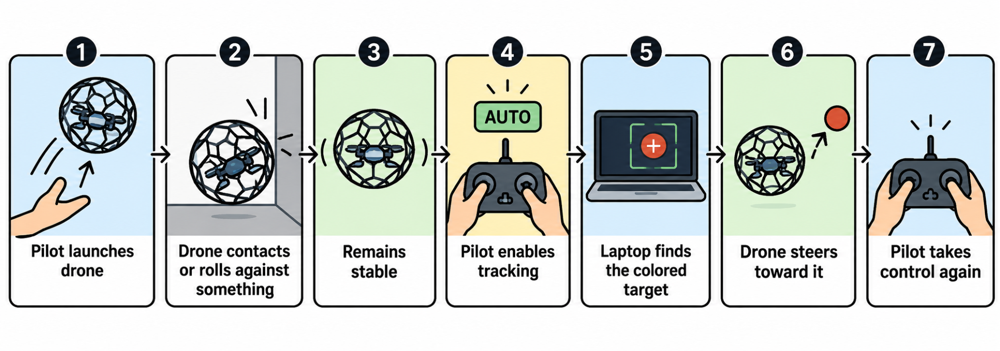

# Source snapshot — Software

Source: https://docs.google.com/document/d/1QrmGZfF8AJm1gQhVAsY_8FbZmaZgIQHXRB_zzldYWVA/edit?tab=t.4nvsq5osusve

Read: 2026-10-07. Tab order: 3; parent: none. 

---

# Software Plan

CORE APPROACH: 

Use Betaflight for stabilization, motor control, failsafes, and normal flying. The outer rolling cage does not need custom software. The Raspberry Pi handles local visual target tracking, steering decisions, and the monitoring server.

SYSTEM FLOW:							   **OpenCV can be replaced

RASPBERRY PI VIDEO / VISION PIPELINE

MEIVIFPV FPV camera → Specter VTX → 5.8 GHz analog FPV → RC832 receiver → yellow RCA composite video → USB capture adapter → Raspberry Pi.

The Raspberry Pi runs Linux and should see the capture adapter through V4L2 (for example /dev/video0).

Run OpenCV target detection and steering decisions locally on the Raspberry Pi before any Wi-Fi streaming.

The Raspberry Pi also runs a lightweight video/telemetry server for remote monitoring over Wi-Fi. The Wi-Fi stream is secondary and must not be part of the control loop.

Use a low-latency stream such as MJPEG, H.264/GStreamer, or WebRTC; avoid HLS for live control monitoring.

Expected camera-to-Pi control-decision latency is roughly 40–150 ms; the USB capture adapter and buffering are the main latency sources. Measure the final end-to-end latency on the actual hardware.

Test Wi-Fi channel selection for interference because the system already uses 2.4 GHz ELRS and 5.8 GHz analog FPV.

SOFTWARE NEEDED:

- Betaflight: normal flight and stabilization.

- Python: Raspberry Pi vision, control, and server program.

- OpenCV: colored target detection and tracking.

- NumPy: simple math and image processing.

- Serial library: sends steering commands.

- Arduino Mega 2560 bridge: passes Raspberry Pi steering commands into the RC transmitter/trainer input.

CONTROL RULES:

- The pilot always controls ARM/DISARM.

- Pilot keeps emergency takeover.

- V1 computer control is yaw-only. The pilot retains throttle, roll, pitch, ARM/DISARM. Add small forward-pitch commands only after yaw centering is repeatable.

- Do not let the Raspberry Pi directly manage throttle for V1.

- If the target is lost, stop computer control immediately and return to manual.

- Clamp all automatic steering commands so they stay small and safe.

TARGET TRACKING:

Use a bright colored target instead of AI object detection.

- Read the FPV video.

- Convert the frame to HSV.

- Find the colored target.

- Find the target center.

- Compare it with the screen center.

- Send a small steering correction.

- For V1, target size is display/decision data only; the pilot manages distance. Add pitch-based approach only after yaw stability is proven.

HACKATHON WORK PLAN:

- Configure Betaflight and ELRS.

- Get stable manual flight.

- Get FPV video into the Raspberry Pi through the RC832 and USB capture adapter.

- Build the color tracker.

- Display target center/error on screen.

- Build Raspberry Pi → RC command bridge.

- Test commands with props removed.

- Test low-power computer steering.

- Tune target following.

- Integrate the cage and retest.

- Practice the demo.

- Reliability testing only.

V1 SOFTWARE DEMO

- Fly manually.

- Detect the colored target and autonomously yaw-center it.

- Lose the target or flip the override switch and return instantly to pilot control.

STRETCH SOFTWARE: 

- Autonomous toss launch.

- Optical-flow navigation.

- LiDAR altitude hold.

- Autonomous landing.

- SLAM or obstacle mapping.

- AI object detection.

- Autonomous wall climbing.

FINAL SOFTWARE ORDER

P0: Betaflight/ELRS → FPV capture → Raspberry Pi → MCU → trainer → radio → ELRS → FC path → physical override/watchdog.

P2: HSV tracker → yaw-only closed loop → target-loss neutral → judge-facing HUD.

P2.5: small pitch-based approach after yaw centering is repeatable.

P3: AprilTag ID + automatic snapshot + CSV mission summary.

PASS / FAIL

-  Override: 20/20 props-off tests, then 5/5 airborne.

- Target loss: computer commands return neutral every test.

- Tracking: no sustained oscillation; command clamp + slew limiting active.

- Measure end-to-end response latency rather than guessing.

DEMO GOAL

## Sources and verification references — 2026-10-07

<!-- audit-source-footer -->
- [Google Doc — Software tab](https://docs.google.com/document/d/1QrmGZfF8AJm1gQhVAsY_8FbZmaZgIQHXRB_zzldYWVA/edit?tab=t.4nvsq5osusve) — source revision `ANLCKQnLVBOUgYbF9xiV7-InTsia-NHBAIK6uRHga-e4J5upeOn-tJgL1FVO9wv0_COaZWscwb-pNlIDnIFEctx2nWF87sQFyqftuH4YmVg`, captured 2026-10-07.
- This citation note was appended after the captured text; it is not part of the source tab.
